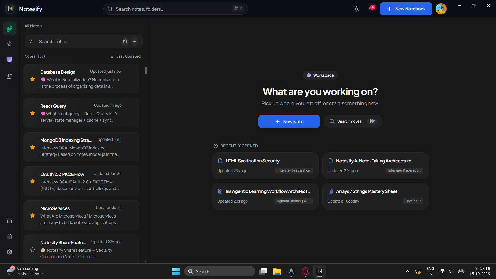

# Notesify

**Notes that turn into quizzes.**

Notesify is an AI-assisted note-taking and learning workspace built to help you capture knowledge, explore it with Iris, and actively test what you've learned.

Write in a rich-text editor, ask Iris questions grounded in your current note or across your other notes, and use the live web when you need more context. Turn your notes into interactive quizzes and flashcard decks. With offline-first desktop support, your notes remain accessible and edits can synchronize when connectivity returns.

**Try Notesify:** [Web app](https://app.notesify.in) · [Landing page](https://notesify.in) · [Windows installer](https://github.com/badalsahani20/notesify/releases) · [Release notes](docs/releases.md)



> **Project status:** Independently built and publicly available. The web app and Windows desktop app are live; Android is in testing and has not been publicly released. Paid subscriptions have not been implemented.

---

## The learning loop

Notesify connects note-taking with understanding and recall. Instead of stopping at storage, it is built around one loop:
1. **Capture** — write in a TipTap editor with Markdown shortcuts, tables, code blocks, Mermaid diagrams, and image uploads.
2. **Ask** — Iris answers from the note you're in, searches your other notes, or reads the live web.
3. **Review** — turn the note into a multiple-choice quiz or a flashcard deck, then work through it.
4. **Keep going offline** — edits queue locally and reconcile with the server when you reconnect.

The goal is to make capturing, exploring, and reviewing knowledge feel like one continuous workflow—even when connectivity is unreliable.

---

## What's shipped
| Area | Status |
|---|---|
| Rich-text editor (TipTap/ProseMirror) | Live |
| Notes, nested notebooks, tags, search, trash | Live |
| Iris chat + inline AI actions | Live |
| Quiz and flashcard generation from notes | Live |
| Offline-first desktop (Electron) | Live, Windows |
| PDF export + Android share sheet | Live |
| Public note sharing | Live |
| Android app | In testing, not publicly released |
| Real-time collaboration | Planned |
| Paid plans | Not implemented |
The detailed version history lives in [docs/releases.md](docs/releases.md).

---

## Architecture

These are the core engineering decisions behind Notesify, especially if you are evaluating the codebase or considering contributing.

### 1. Offline-first with real conflict resolution

The desktop client is not a thin wrapper around the API. Notes and folders live in Dexie (IndexedDB) and render from local state first.
- **Mutation queue** — offline writes are stored in order and replayed when connectivity returns.
- **Optimistic concurrency** — every note carries a `version` counter. Updates send the version they started from; a stale write gets `409 Conflict` instead of silently overwriting.
- **Conflict UI** — a side-by-side diff with **Keep local**, **Keep remote**, and **Smart merge**. The local draft is snapshotted at conflict time so a concurrent autosave can't contaminate the resolution.
- **Cross-tab sync** — resolving a conflict broadcasts through `BroadcastChannel`, so other open tabs update without a reload.

Relevant code: `frontend/src/database/`, `frontend/src/services/SyncService.ts`, `frontend/src/components/notes/` (conflict banner and modal), `backend/src/services/notes.service.js`.

### 2. AI routing that degrades instead of failing

Iris is not tied to one provider. Requests route across OpenRouter, Google Gemini, and Groq, with tiered fallbacks:
- **Fast** for short writing tasks, **Thinking** for reasoning, **Pro** for long context and vision.
- Provider failures cascade to the next tier rather than surfacing an error.
- Identical assist requests are hashed (SHA-256) and served from MongoDB before any model is called.
- Static prompt prefixes use ephemeral prompt caching to cut repeat latency and token cost.
- Daily token budgets and per-user concurrency limits keep usage bounded.

Relevant code: `backend/src/services/ai/`.

### 3. Streaming that doesn't re-render the app

Token streaming is easy to get wrong: one state update per chunk re-renders the whole message list. Notesify separates the active stream from stored messages.
- SSE is parsed into a velocity-paced reveal buffer, synced to the display refresh rate (60 or 120 Hz).
- Active tokens live in a transient store; historical messages don't re-render while text streams.
- Incomplete Mermaid blocks are intercepted mid-stream and compiled only after the closing fence arrives.

Relevant code: `frontend/src/hooks/ai/`, `frontend/src/utils/consumeAiChatStream.ts`, `frontend/src/components/chat/`.

### 4. Agentic tools with bounds

Iris uses native tool calling inside a bounded execution loop, allowing it to interact with the user's workspace rather than merely suggesting actions.

- **Note retrieval** — `search_notes` and `get_note_content` retrieve notes for contextual answers, scoped to the requesting user.
- **Note authoring** — `create_note` and `update_note` let Iris create and modify notes through chat.
- **User-confirmed actions** — Creating and deleting notes requires explicit user confirmation through a request modal before the action proceeds.
- **Interactive learning** — `ask_question` presents questions through an interactive dialog for clarification and self-quizzing.
- **Persistent preferences** — `save_memory` stores supported preferences beyond the current session.
- **Web research** — `search_web` retrieves live web results when a search provider is configured, while `crawl_url` fetches the contents of a public webpage.

Every tool call is schema-validated, and the agent loop has a hard round limit. Note operations remain subject to backend authorization. Iris decides when web tools are appropriate, without requiring a manual web-search toggle.

Web search is provider-agnostic. Exa and Parallel sit behind one adapter (`backend/src/services/ai/search/searchAdapter.js`) that normalizes results, dedupes by URL, and never throws — a failed provider falls through to the next. Each provider can hold several keys: a key that returns 401/402/403/429 rotates to the next one, and the last working key is reused on later requests. With no search key configured, search stays delegated to OpenRouter's built-in tool. If the local adapter returns nothing, OpenRouter's search is re-armed for the next round.

`crawl_url` is a native fetcher (`backend/src/services/ai/search/webFetch.js`): no key, works on every transport, and replaces `openrouter:web_fetch` by default because Groq and Gemini strip provider-specific tools. It refuses localhost, private ranges, and non-http(s) URLs, re-validates every redirect hop, and caps the response at 2 MB / 12k characters. Set `WEB_FETCH_PROVIDER=openrouter` to use the provider tool instead.

The system prompt and tool list are cached: the constitution carries a block-level `cache_control` breakpoint and the last tool overall carries one too. Because the tool array is part of the cached prefix, `getChatTools()` keeps its shape stable per configuration — adding or removing a tool invalidates that prefix.

### Context budgeting

Long chats don't get truncated by turn count. The resolver walks history backwards to fit a dynamic token budget (18k high watermark, 10k low watermark by default), then summarizes older messages into a running technical summary that preserves decisions and identifiers. See `backend/src/services/ai/chatContextResolver.js`.

---

## Technology stack
| Layer | Technology |
|---|---|
| Frontend | React 19, Vite 7, TypeScript |
| Editor | TipTap 3 / ProseMirror, KaTeX, Mermaid |
| Client state | TanStack Query 5, Zustand 5, Dexie 4 |
| Styling | Tailwind CSS 4, shadcn/ui, Framer Motion |
| Backend | Node.js, Express 5 |
| Database | MongoDB + Mongoose 8 |
| Cache | Upstash Redis |
| Auth | Passport, JWT, refresh rotation, PKCE for desktop OAuth |
| AI | OpenRouter, Google Gemini, Groq |
| Desktop | Electron 33 + electron-builder (NSIS) |
| Media | Cloudinary |
| Email | Nodemailer |
---

## Project structure
```text
fullstack-notes/
├── backend/
│   └── src/
│       ├── controllers/       # HTTP handlers
│       ├── middleware/        # Auth, verification, AI rate limits
│       ├── models/            # Mongoose schemas (users, notes, sessions)
│       ├── routes/            # Express routers
│       ├── services/          # Notes, study, memory, title generation
│       │   └── ai/            # Router, transports, agent loop, streaming
│       └── utils/
├── frontend/
│   └── src/
│       ├── components/        # Editor, chat, notes, folders, study, ui
│       ├── database/          # Dexie schemas
│       ├── extensions/        # Custom TipTap extensions
│       ├── hooks/             # Query, AI, notes, study
│       ├── services/          # Sync, conflict resolution, PDF, AI clients
│       ├── store/             # Zustand stores
│       └── utils/
├── desktop/                   # Electron main, preload, offline screen
└── landing/                   # Marketing site, docs, privacy, terms
```

---

## Running locally

### Prerequisites
- Node.js 20+
- MongoDB (local or Atlas)
- Upstash Redis (REST URL + token)
- Cloudinary account
- API keys for OpenRouter, Google AI Studio, and Groq

### Backend
```bash
cd backend
npm install
```

Create `backend/.env`:
```env
PORT=5000
NODE_ENV=development
DB_URI=your_mongodb_connection_string
BACKEND_URL=http://localhost:5000
FRONTEND_URL=http://localhost:5173
JWT_SECRET=your_jwt_secret
REFRESH_SECRET=your_refresh_secret
JWT_EXPIRES_IN=15m
GOOGLE_CLIENT_ID=your_google_client_id
GOOGLE_CLIENT_SECRET=your_google_client_secret
GOOGLE_CALLBACK_URL=http://localhost:5000/api/auth/google/callback
UPSTASH_REDIS_REST_URL=your_upstash_url
UPSTASH_REDIS_REST_TOKEN=your_upstash_token
OPENROUTER_API_KEY=your_openrouter_key
GEMINI_API_KEY=your_gemini_key
GROQ_API_KEY=your_groq_key
# Optional: provider-agnostic web search.
# Unset -> use any provider that has a key (exa -> parallel).
# SEARCH_PROVIDER=openrouter -> always use OpenRouter's built-in search.
SEARCH_PROVIDER=
EXA_API_KEY=
PARALLEL_API_KEY=
# Extra keys per provider. Either form works; numbered slots go up to _10.
#   EXA_API_KEYS=key1,key2   or   EXA_API_KEY_2=key2
# A key that is invalid, unpaid, or rate-limited rotates to the next one.
EXA_API_KEYS=
EXA_API_KEY_2=
PARALLEL_API_KEYS=
PARALLEL_API_KEY_2=
# Optional: native crawl_url vs provider fetch.
# Unset -> native fetch. WEB_FETCH_PROVIDER=openrouter -> openrouter:web_fetch.
WEB_FETCH_PROVIDER=
CLOUDINARY_CLOUD_NAME=your_cloud_name
CLOUDINARY_API_KEY=your_cloudinary_key
CLOUDINARY_API_SECRET=your_cloudinary_secret
CLOUDINARY_UPLOAD_PRESET=your_unsigned_preset
MAIL_HOST=smtp.gmail.com
MAIL_PORT=587
MAIL_USER=your_email@gmail.com
MAIL_PASS=your_app_password
```
```bash
npm run dev
```

### Frontend
```bash
cd frontend
npm install
```

Create `frontend/.env`:
```env
VITE_API_URL=http://localhost:5000/api
VITE_APP_URL=http://localhost:5173
VITE_CLOUDINARY_CLOUD_NAME=your_cloud_name
VITE_CLOUDINARY_UPLOAD_PRESET=your_unsigned_preset
```
```bash
npm run dev
```

### Desktop shell

From the repository root:
```bash
npm install
npm run desktop:dev        # backend + frontend + Electron
npm run build:desktop      # Windows installer in dist-desktop-build/
```

### Tests and checks
```bash
cd backend && npm test     # 172 tests, 16 suites
cd frontend && npx tsc -b  # type check
cd frontend && npm run lint
```

`npm run lint` is error-free. It reports warnings for tracked type-safety debt (`any`), exhaustive-deps, and React Fast Refresh boundaries.

---

## Current limitations and roadmap
- No real-time collaborative editing or comments. Both are on the roadmap.
- Android is built and tested locally but not released.
- No payment or subscription flow. The `plan.tier` field exists, but there is no checkout.
- Windows is the only packaged desktop target.
- The AI features depend on third-party keys; a fresh clone needs all of them to exercise the full loop.

Security issues: see [SECURITY.md](SECURITY.md).

## License

MIT — see [LICENSE](LICENSE).
