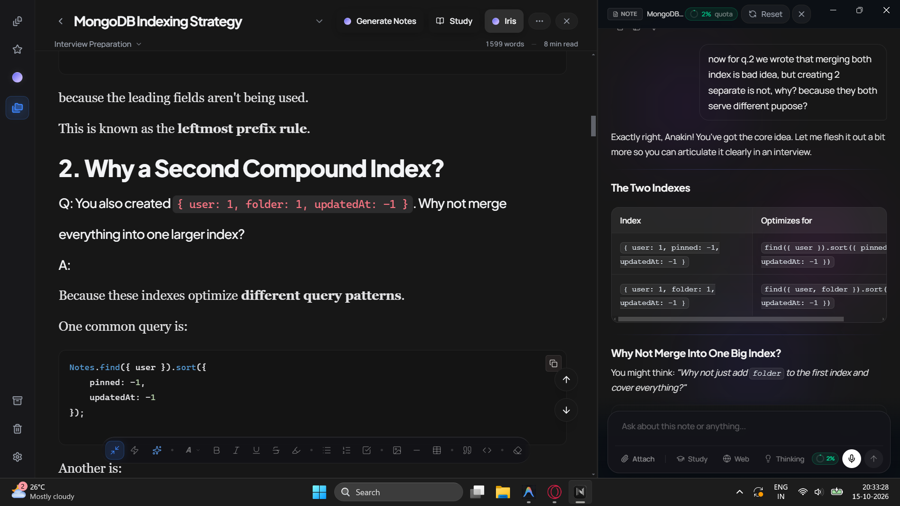
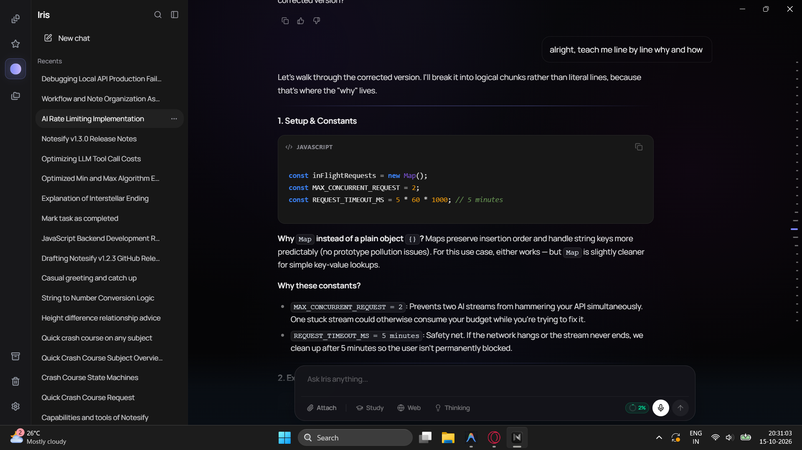
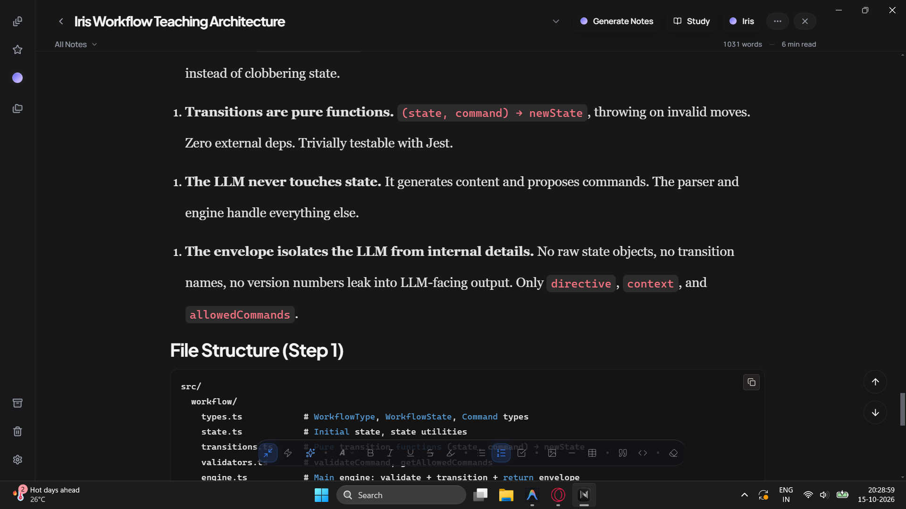

# Notesify

A production-grade, full-stack notes and intelligent thinking workspace built on the MERN stack — featuring a professional rich-text editor, multi-provider AI orchestration, offline-first Dexie synchronization, optimistic concurrency control with conflict resolution, and robust, secure authentication.

**[Live Demo](https://notesify.in) · [GitHub Releases](https://github.com/badalsahani20/notesify/releases) · [Documentation](https://github.com/badalsahani20/notesify#architecture-highlights)**

<p align="center">
  
</p>

---

## 🚀 What's New in v1.3.0

- **Fair-Use AI Quotas & Concurrency Limiting:** Daily token tracking with UTC midnight auto-reset across Free (100k), Pro (500k), and Enterprise (2M) tiers, paired with concurrency semaphores to protect API limits while keeping interactions fair.(Currently Free)
- **Token-Budget History & Sliding Context Summarization:** Dynamic 8,000-token sliding window with provider-independent estimation. Messages overflowing the token budget are seamlessly consolidated in the background into an actionable, state-preserving summary without arbitrary turn truncation.
- **OCC Conflict Resolution & Visual Merging UI:** When multi-device edits cause an Optimistic Concurrency Control (OCC) conflict (`409 Conflict`), Notesify displays an interactive Note Conflict Banner and Modal allowing side-by-side diffing with **Keep Local**, **Keep Remote**, and **Smart Merge** resolution strategies.
- **Live Title Sync with Typewriter Feedback:** Global AI Chat sessions dynamically synthesize succinct 3–6 word topic titles in the background, updating active sidebar headers with a smooth typewriter animation.
- **Native LaTeX Mathematics (KaTeX):** Iris now formats mathematical formulas and equations in standard LaTeX notation (both inline `$x$` and block `$$...$$`), seamlessly rendered with KaTeX.
- **Butter-Smooth Iris Panel & Layout Polish:** Guarded layout transitions in `AppLayout` and stabilized session sync eliminate Global Chat drawer stutter and resize jitter.

---

## 📜 Previous Release Highlights

<details>
<summary><strong>v1.2.3 — Agentic Learning Tasks & Composer Polish</strong></summary>

- **Agentic Learning Tasks Queue:** Iris can create, track, and update concrete practice milestones docked above the composer bar with smooth spring physics.
- **Permanent Learning Archive:** Completed milestones graduate into a permanent archive for long-term mastery analytics without polluting the active prompt context.
- **Native Tool Calling Protocol:** Strict native `role: "tool"` schemas, eliminating simulated text tags and model hallucinations.
- **Desktop Focus Mode Sync:** Header titlebar clearance dynamically applies only in fullscreen and focus modes for edge-to-edge desktop reading.
</details>

<details>
<summary><strong>v1.2.2 — Streaming Iris, Interactive Tools & Inline Citations</strong></summary>

- **Interactive Question Dialogs (`ask_question`):** Iris autonomously triggers rich modal dialogs for knowledge quizzes, requirement clarifications, preference selection, and priority ranking (`single_select`, `multi_select`, `rank_priority`).
- **AI Reasoning / Thought Trace Viewer:** Collapsible `ReasoningCollapsible` component provides full visibility into Iris's multi-step chain-of-thought.
- **Inline Note Citations:** Clickable note references (`[cite: noteId]`) render directly inside chat responses with instant popover previews and navigation.
- **Real-Time Streaming Shimmer:** Fluid token-by-token streaming with animated shimmer indicators and responsive stream cancellation.
</details>

<details>
<summary><strong>v1.2.1 — STT Voice Dictation & Chat Polish</strong></summary>

- **STT Voice Dictation:** Hands-free voice transcription inside the Iris compose bar powered by OpenRouter Whisper Large V3 Turbo with automatic language detection.
- **Refined Conversation Sidebar:** Clean, minimalist dark conversation history with instant in-place search and quick session switching.
- **Uncapped Conversations:** Seamlessly load and navigate your complete chat history without artificial session caps.
</details>

<details>
<summary><strong>v1.2.0 — Bounded Agentic Loop & On-Demand Retrieval</strong></summary>

- **Bounded Agentic Loop:** Server-side multi-round reasoning loop (`Round 1/3` → `Round 2/3`) in a single continuous SSE stream.
- **On-Demand Contextual Retrieval (`get_note_content`):** Iris fetches full note contents only when editor context is insufficient, enforcing strict user ownership.
- **Global Note Actions (`create_note`, `update_note`):** Create and update notes directly from Global Chat without navigating into the editor.
- **Minimalist Telemetry:** Lightweight ephemeral status indicators (`Reading note...`, `Searching the web...`) that automatically dissolve when streaming begins.
</details>

<details>
<summary><strong>v1.1.0 — Offline-First Desktop & DPI-Aware Installer</strong></summary>

- **Offline-First Dexie Workspace:** Packaged Electron app operates completely offline via bundled assets and Dexie.js (IndexedDB) with bidirectional queue synchronization on reconnection.
- **Per-Monitor V2 DPI Awareness:** NSIS Windows installer configured with native Per-Monitor V2 DPI scaling, preventing blurry text at 125%, 150%, and 200% display scaling.
- **Gemini 3.5 Flash Lite:** Ultra-low-latency title synthesis and long-term conversation summarization.
</details>

---

## Architecture Highlights

These engineering decisions separate Notesify from basic CRUD note-taking applications.

### 1. Offline-First Architecture & Dual Synchronization
Notesify's desktop client functions as a standalone, offline-first application powered by Dexie.js (IndexedDB) and an asynchronous background sync reconciler:
- **Zero-Latency Local Execution:** Notes and folders render, mutate, and index locally in sub-millisecond time.
- **Asynchronous Mutation Queue:** Offline mutations are queued in IndexedDB and replayed in order once connectivity returns.
- **Safe State Teardown:** Packaged Electron runs under `file://` with `HashRouter`. Logout declaratively purges Dexie caches, React Query stores, and Electron `safeStorage` keys without unauthenticated background leaks.

### 2. Optimistic Concurrency Control (OCC) & Conflict Resolution
Every core document carries a monotonic `version` counter:
- **Version Verification:** Every update payload sends its known `version`. Concurrent edits return an HTTP `409 Conflict`.
- **Interactive Conflict Resolver:** Rather than silently discarding edits or overwriting work, Notesify surfaces a dedicated `NoteConflictModal` with side-by-side diff views:
  - **Keep Local:** Overwrite server with current client edits.
  - **Keep Remote:** Discard local edits and accept latest server state.
  - **Smart Merge:** Intelligently combines non-overlapping paragraphs and changes from both versions.

### 3. Multi-Provider AI Orchestration
Iris AI dynamically balances speed, intelligence, and cost across specialized providers with cascading fallbacks:

| Provider | Model / Endpoint | Role / Capability |
|---|---|---|
| OpenRouter | DeepSeek V4 Flash (`deepseek-v4-flash-0731`) | Primary model for complex logic, long-context reasoning, and code |
| OpenRouter | Qwen 3.7 Flash (`qwen3.7-flash`) | Default high-speed conversational chat & visual analysis |
| OpenRouter | GLM 5.3 Flash (`z-ai/glm-5.3-flash`) | Deep reasoning traces and structural diagram generation |
| OpenRouter | Ling 3.0 Flash (`inclusionai/ling-3.0-flash`) | Rapid operations, math, and high-frequency document analysis |
| OpenRouter | Whisper Large V3 Turbo (`whisper-large-v3-turbo`) | Fast multi-lingual Speech-to-Text (STT) voice dictation |
| Groq | OpenAI GPT-OSS 120B / 20B | High-speed conversational fallback and fast summarization |
| Google Gemini | Gemini 3.5 Flash Lite (`gemini-3.5-flash-lite`) | Sub-second conversation title generation & context compression |

*Cascading Fallback Chain:* DeepSeek → Groq (GPT-OSS 120B) → OpenRouter Fallback on transient API downtime.

### 4. Fair-Use Token Budgeting & Tiered Quotas
To balance heavy AI usage with operational sustainability:
- **Tiered Allowances:** Daily token allocations tailored to user tiers (Free: 100k, Pro: 500k, Enterprise: 2M).
- **UTC Midnight Reset:** Deterministic boundary resets across timezones via `getStartOfUtcDay()`.
- **Concurrency Semaphores:** Per-user concurrent request limits prevent race conditions and runaway token depletion.
- **Interactive UI Indicator:** Visual usage badge in the chat composer displays daily quota consumption with contextual warnings.

### 5. Autonomous Agentic Tools & Human-in-the-Loop Dialogs
Iris employs native function calling (`role: "tool"`) within a bounded execution loop (max 3 rounds):
- `save_memory`: Autonomously stores user preferences, projects, and goals into long-term recall.
- `ask_question`: Triggers interactive multi-choice or rank-ordering modal dialogs when requirements are ambiguous or when testing knowledge.
- `get_note_content`: Selectively fetches active note content on demand using strict `noteId` ownership validation.
- `create_note` & `update_note`: Directly authors or patches notes with append/replace modes.

### 6. Token-Budget Rolling Context & Autonomous Summarization
Rather than relying on arbitrary message turn counts that fail when conversations include large code snippets or verbose outputs, Notesify implements a strict token-budget sliding window:
- **8,000-Token Active Budget:** Context resolver evaluates history backwards from the newest message to keep immediate, high-fidelity context within an 8,000-token allowance (configurable via `CHAT_RECENT_HISTORY_TOKEN_BUDGET`).
- **Provider-Independent Token Estimator:** Accurately models Unicode pieces, CJK glyphs (1:1), words (~4 chars/token), punctuation, and message framing overhead.
- **3-Tier Consolidated Summarization:** Overflowing older messages outside the budget are automatically summarized and merged into a running technical context snapshot (300–600 words preserving decisions, identifiers, and next steps) via a 3-tier fallback:
  1. *Tier 1:* Google Gemini 3.5 Flash Lite (`gemini-3.5-flash-lite`, 1M TPM context)
  2. *Tier 2:* OpenRouter (`inclusionai/ling-3.0-flash` with reasoning stripped for zero latency)
  3. *Tier 3:* Groq (`openai/gpt-oss-20b`)

### 7. Real-Time Web Search & Source Citations
- Iris integrates live web retrieval via OpenRouter Exa tools (`openrouter:web_search` and `openrouter:web_fetch`).
- Extracts concise search queries from natural language requests.
- Streams live telemetry (`Searching the web for "..."`) and renders interactive citation badges with source URLs and favicons.

### 8. Enterprise-Grade Desktop Security (PKCE)
- Desktop Google OAuth triggers through the operating system's native browser with a cryptographically random, memory-resident PKCE challenge.
- Session tokens are encrypted on Windows and macOS using Electron's `safeStorage` (Windows DPAPI / macOS Keychain) via isolated IPC channels.

### 9. Self-Healing Redis Cache & Content-Hashed AI Caching
- **Upstash Redis:** Caches note listings and folder hierarchies for sub-10ms reads. Automatic cache invalidation on mutation with self-healing re-seeds on cache drift.
- **SHA-256 AI Deduplication:** Text transformation requests (Improve, Summarize, Fix Grammar) are hashed with SHA-256; identical prompts return instantly from MongoDB cache.

---

## Features

### Iris AI — Intelligent Workspace Assistant



- **Inline Ghostwriter:** Custom TipTap extension displaying faint ghost-text suggestions inline as you type.
- **Floating Selection Toolbar:** Bubble menu on highlighted text for instant AI operations: *Improve*, *Summarize*, *Rewrite*, *Brainstorm*.
- **Grammar Audit Panel:** Scans notes for syntactical and stylistic improvements with one-click corrections.
- **Multimodal Visual Analysis:** Paste or attach images to discuss diagrams, math problems, or screenshots.
- **Speech-to-Text Voice Dictation:** Compose prompts hands-free using Whisper Large V3 Turbo with automatic language detection.



- **Streaming Thought Traces:** Collapsible `ReasoningCollapsible` widget displays real-time chain-of-thought traces.
- **Interactive Question Dialogs:** Rich question modals (`ask_question`) for self-quizzing, requirement clarification, or preference ranking.
- **Inline Note Citations:** Direct `[cite: noteId]` links allowing one-click preview and navigation to referenced knowledge.
- **LaTeX Math Support:** Complete KaTeX mathematical expression rendering for formulas, proofs, and equations.
- **Autonomous Long-Term Memory:** Remembers developer background, tech stacks, and user preferences across chat sessions via `save_memory`.
- **Live Web Retrieval:** Fetches up-to-date documentation and current events with real-time streaming telemetry and source badges.
- **PDF Extraction Pipeline:** Upload `.pdf` documents directly; parsed backend via `pdf-parse` and integrated into conversation context.

### Professional Rich-Text Editor



- **Markdown Shortcuts:** Full Markdown syntax support for headers, blockquotes, bold, italic, and lists.
- **Tables & Tasks:** Resizable interactive tables, checklist task items, and indented bullet hierarchies.
- **Code Highlighting:** Lowlight auto-detected syntax highlighting across 40+ programming languages.
- **Cloudinary Image Uploads:** Drag-and-drop or clipboard paste with automated image compression and Cloudinary CDN hosting.

### Organization & Search
- **Nested Notebook Hierarchies:** Deep folder trees with lazy-loaded subfolders and dynamic note counters.
- **Favorites & Soft-Delete Trash:** Pin essential notes to quick access; restore or permanently purge trashed notes.
- **Command Palette (O(1) Search):** Fast search across note titles, contents, and folders with highlight snippets and keyboard shortcuts (`Cmd/Ctrl + K`).
- **Public Note Sharing:** Generate shareable web links (`/shared/:slug`) with protocol-aware resolution across web and desktop.

---

## Tech Stack

### Frontend
| Layer | Technology |
|---|---|
| Core Framework | React 18 (Vite) + TypeScript |
| Server State | TanStack React Query v5 |
| Client State & Offline DB | Zustand + Dexie.js (IndexedDB) |
| Styling | TailwindCSS v4 + shadcn/ui + Lucide Icons + Tabler Icons |
| Editor Engine | TipTap v3 (ProseMirror) + Custom Extensions |
| Math Rendering | KaTeX |
| Animations | Framer Motion v12 |
| Desktop Shell | Electron v33 + Electron Builder (NSIS Installer) |

### Backend
| Layer | Technology |
|---|---|
| Runtime & Framework | Node.js + Express 5 |
| Database | MongoDB + Mongoose (Optimistic Concurrency Control) |
| In-Memory Caching | Upstash Redis (REST API) |
| Authentication | Passport.js + JWT (PKCE & Refresh Token Rotation) |
| Email Service | Nodemailer |
| AI Services | OpenRouter, Google Gemini, Groq |
| Audio STT | Whisper Large V3 Turbo |
| Media Storage | Cloudinary CDN |

---

## Project Structure

```text
fullstack-notes/
├── backend/
│   ├── src/
│   │   ├── controllers/            # Express request handlers
│   │   │   ├── ai.controller.js    # Iris AI stream, chat & suggestions
│   │   │   ├── auth.controller.js  # JWT, refresh rotation, Google OAuth
│   │   │   ├── notes.controller.js # Notes CRUD & OCC versioning
│   │   │   ├── stt.controller.js   # Whisper audio transcription
│   │   │   ├── user.controller.js  # Profile stats & token quota status
│   │   │   └── workflow.controller.js
│   │   ├── middleware/             # Security, auth & rate limiting
│   │   │   ├── aiRateLimit.middleware.js # Daily token quota & concurrency
│   │   │   ├── auth.middleware.js  # Access token verification
│   │   │   └── verified.middleware.js
│   │   ├── models/                 # Mongoose schemas
│   │   │   ├── user.model.js       # User profile, plans & daily usage
│   │   │   ├── notes.model.js      # OCC versioned notes & share slugs
│   │   │   └── globalChatSession.model.js # Chat history & tool calls
│   │   ├── routes/                 # Express API routes
│   │   │   ├── aiRoute.js
│   │   │   ├── auth.route.js
│   │   │   ├── notes.route.js
│   │   │   ├── public.route.js     # Public note sharing & prompt catalog
│   │   │   └── stt.route.js        # Voice dictation endpoint
│   │   ├── services/               # Core business & AI services
│   │   │   ├── ai/                 # Modular AI orchestration engine
│   │   │   │   ├── agent/          # Iris agentic execution loop
│   │   │   │   ├── config/         # Model definitions & API clients
│   │   │   │   ├── router/         # Dynamic model & intent router
│   │   │   │   ├── stream/         # SSE streaming & telemetry dispatcher
│   │   │   │   ├── tools/          # Tool schemas (memory, ask, note CRUD)
│   │   │   │   └── transport/      # OpenRouter, Groq & Gemini clients
│   │   │   ├── memoryService.js    # Long-term indexed vector recall
│   │   │   ├── notes.service.js    # Notes CRUD & Redis cache sync
│   │   │   └── title.service.js    # Gemini 3.5 Flash Lite title generator
│   │   └── utils/                  # Diffing, HTML stripping & token budgeting
│   └── server.js                   # Backend server entry point
│
├── frontend/
│   ├── src/
│   │   ├── components/
│   │   │   ├── ai/                 # Telemetry & AI message UI
│   │   │   ├── chat/               # Global AI chat, compose bar & modals
│   │   │   │   ├── AiUsageContextIndicator.tsx # Quota & token counter
│   │   │   │   ├── InteractivePromptDialog.tsx # ask_question tool modal
│   │   │   │   ├── SelectionToolbar.tsx        # Floating editor toolbar
│   │   │   │   └── VoiceDictationButton.tsx    # Whisper STT button
│   │   │   ├── editor/             # TipTap wrappers, bubble bar & toolbar
│   │   │   ├── notes/              # Note cards, conflict banner & modal
│   │   │   ├── folders/            # Nested notebook folder hierarchy
│   │   │   ├── search/             # Global command palette
│   │   │   └── ui/                 # KaTeX, reasoning collapsible & shadcn
│   │   ├── database/               # Dexie.js offline IndexedDB schemas
│   │   ├── extensions/             # Custom TipTap extensions (Ghostwriter)
│   │   ├── hooks/                  # TanStack Query & domain hooks
│   │   ├── services/               # SyncService & ConflictResolutionService
│   │   ├── store/                  # Zustand global state
│   │   └── utils/                  # Share link resolver & string helpers
│   └── main.tsx                    # React client entry point
│
├── desktop/                        # Electron desktop runtime
│   ├── main.js                     # BrowserWindow, PKCE bridge & safeStorage
│   ├── preload.cjs                 # Secure contextBridge API
│   └── offline.html                # Offline fallback screen
│
└── landing/                        # Product landing page & release catalog
```

---

## Local Development Setup

### Prerequisites
- Node.js v18 or later
- MongoDB connection URI
- Upstash Redis database (REST API URL & Token)
- Cloudinary credentials
- AI API Keys: [OpenRouter](https://openrouter.ai), [Google AI Studio](https://aistudio.google.com), [Groq](https://console.groq.com)

### 1. Clone the repository
```bash
git clone https://github.com/badalsahani20/notesify.git
cd notesify
```

### 2. Backend Setup
```bash
cd backend
npm install
```

Create a `.env` file in `backend/`:
```env
PORT=5000
NODE_ENV=development
DB_URI=your_mongodb_connection_string
BACKEND_URL=http://localhost:5000
FRONTEND_URL=http://localhost:5173

# Authentication & Tokens
JWT_SECRET=your_jwt_secret_key
REFRESH_SECRET=your_refresh_secret_key
JWT_EXPIRES_IN=15m

# Google OAuth
GOOGLE_CLIENT_ID=your_google_client_id
GOOGLE_CLIENT_SECRET=your_google_client_secret
GOOGLE_CALLBACK_URL=http://localhost:5000/api/auth/google/callback

# In-Memory Cache
UPSTASH_REDIS_REST_URL=your_upstash_redis_rest_url
UPSTASH_REDIS_REST_TOKEN=your_upstash_redis_rest_token

# AI Providers
OPENROUTER_API_KEY=your_openrouter_api_key
GEMINI_API_KEY=your_gemini_api_key
GROQ_API_KEY=your_groq_api_key

# Daily Token Quotas (Optional defaults)
AI_DAILY_TOKEN_LIMIT_FREE=100000
AI_DAILY_TOKEN_LIMIT_PRO=500000
AI_DAILY_TOKEN_LIMIT_ENTERPRISE=2000000

# Cloudinary Media
CLOUDINARY_CLOUD_NAME=your_cloudinary_name
CLOUDINARY_API_KEY=your_cloudinary_api_key
CLOUDINARY_API_SECRET=your_cloudinary_api_secret
CLOUDINARY_UPLOAD_PRESET=your_unsigned_preset

# Nodemailer SMTP
MAIL_HOST=smtp.gmail.com
MAIL_PORT=587
MAIL_USER=your_email@gmail.com
MAIL_PASS=your_app_password
```

Start the backend development server:
```bash
npm run dev
```

### 3. Frontend Setup
```bash
cd ../frontend
npm install
```

Create a `.env` file in `frontend/`:
```env
VITE_API_URL=http://localhost:5000/api
VITE_APP_URL=http://localhost:5173
VITE_CLOUDINARY_CLOUD_NAME=your_cloudinary_name
VITE_CLOUDINARY_UPLOAD_PRESET=your_unsigned_preset
```

Start the frontend development server:
```bash
npm run dev
```

### 4. Desktop Client (Electron) Setup
To run the full stack alongside the native Electron desktop shell:
```bash
# From workspace root
npm install
npm run desktop:dev
```

To package a standalone Windows installer (`.exe`):
```bash
npm run build:desktop
```
The output installer will be generated in `dist-desktop-build/`.

### 5. Running Tests
Backend automated test suite covers controllers, rate limiters, and memory services using Jest and `mongodb-memory-server`:
```bash
cd backend
npm run test
```

---

*Built with focus on craftsmanship, local-first resilience, and fluid human-AI collaboration.*
